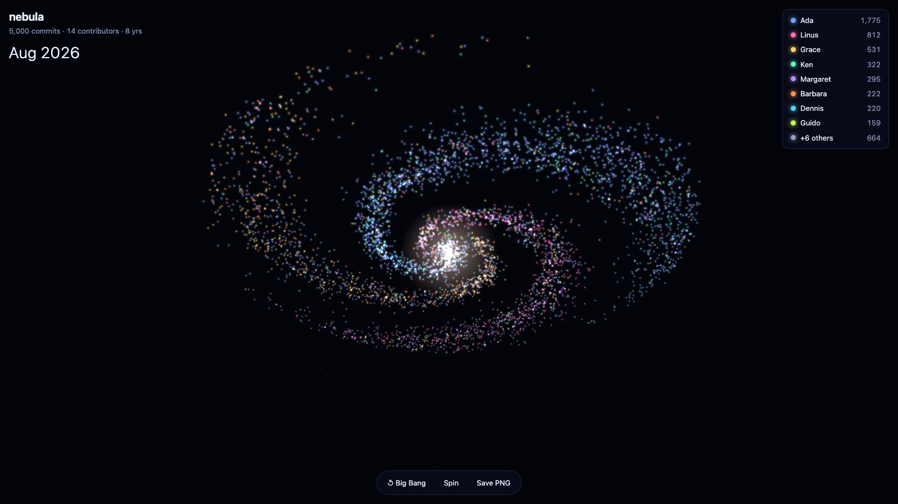
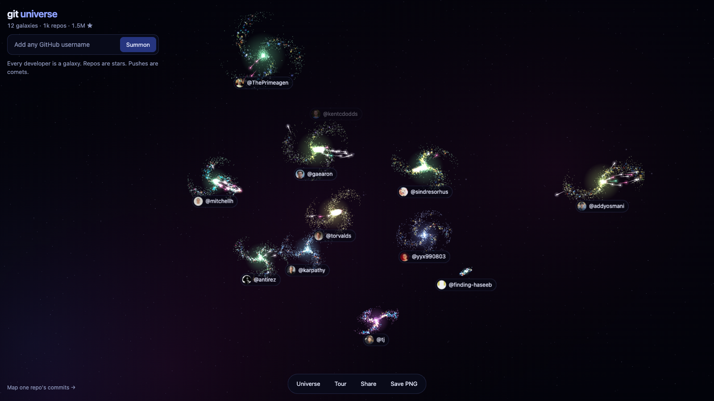

<div align="center">

# ✦ git-galaxy

**Your repo is a galaxy. You just haven't seen it yet.**

[**✦ Explore the git universe**](https://finding-haseeb.github.io/git-galaxy/) · [repo galaxy demo](https://finding-haseeb.github.io/git-galaxy/galaxy.html)

Every commit is a star. Every contributor is a color.
The first commits are the core. Today's commit is the outer edge.



</div>

## git universe: every developer is a galaxy



[Open it](https://finding-haseeb.github.io/git-galaxy/) and type any GitHub username. A new galaxy forms:

- **Repos are stars.** Older repos sit near the core, newer ones at the rim. Brighter means more ★, and the color is the language.
- **Activity is comets.** Pushes (white), pull requests (pink), new branches (green) and issues (yellow) from the last 90 days fly from the core to the repo they touched.
- **Repos they contributed to** but don't own orbit in the halo.
- **Click a galaxy** to fly in and see the profile. Click a star to open the repo. **Tour** flies through every galaxy.
- **Share** copies a link to your exact universe (`#u=torvalds,gaearon,you`).

It runs in the browser on GitHub's public API, which allows 60 lookups an hour without a login. The default universe is a snapshot made with `tools/bake.py`, so it opens instantly.

## Run it (10 seconds, zero dependencies)

From inside any git repo:

```bash
curl -sL https://raw.githubusercontent.com/finding-haseeb/git-galaxy/main/galaxy.py | python3 -
```

Or clone it and point it anywhere:

```bash
python3 galaxy.py ~/code/linux
```

It reads `git log` and writes a single HTML file. Then it opens your browser and **replays your repo's history as a Big Bang**. Nothing is uploaded anywhere.

## What you can do

- **Watch it form:** the galaxy grows from the first commit to the latest one. Press `space` to replay.
- **Drag** to orbit, **scroll** to zoom.
- **Hover a star** to read its commit message, author, date and lines changed.
- **Click a contributor** to light up only their stars.
- **Save PNG** for a shareable image, stamped with your repo name.

The shape comes from the repo name, so the same repo always grows the same galaxy. Bigger commits make brighter stars. Quiet years leave dark gaps.

## Options

```
python3 galaxy.py [repo] [-o out.html] [--max N] [--no-open]
```

| flag | default | |
|---|---|---|
| `repo` | `.` | path to any git repo |
| `-o` | temp file | where to write the HTML |
| `--max` | `30000` | max stars to draw (huge repos are sampled evenly) |
| `--no-open` | off | don't launch the browser |

Needs Python 3.8+ and git. Merge commits are skipped.

## Star goal

**100,000,000,000,000.**

GitHub has about 150 million users, so we only need each of you to star this about 666,667 times.
Or star it once and post your galaxy. That works too. ⭐

## License

MIT
